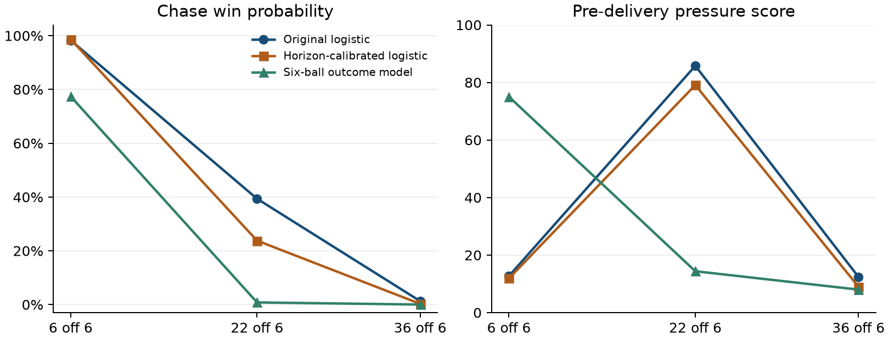
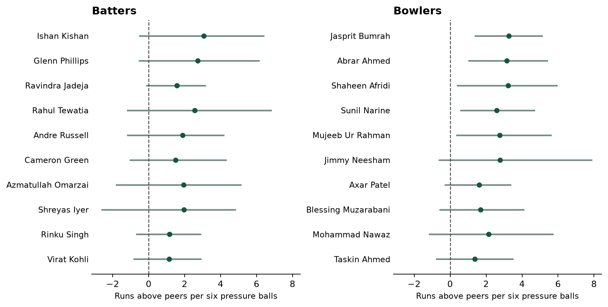

# T20 performance under pressure

Ishan Kishan leads the batting list and Jasprit Bumrah leads the bowling list. Each combined positive value against contextual peers with an improvement over their own ordinary performances. We order qualifying players by a conservative estimate of the size of their contribution across matches.

## What makes a delivery consequential

A delivery matters when its plausible outcomes could move the chance of winning. A team chasing 22 from six balls can still turn the contest. When 36 are needed, many plausible outcomes leave the result effectively settled. We score the situation before the ball, then measure how the player responded.

## Which cricket enters the decision

The supplied files contain 200,999 events in 867 matches with deliveries. Reconstruction leaves 142,280 structurally eligible events. Earlier-match support allows 113,031 pressure scores. Our final IPL and T20I comparison supports 50 batters and 63 bowlers before requiring positive quality and uplift.

## What the evidence can support

Role and opposition improve expectations for scoring. Recent setbacks and selection history produce much weaker and less stable gains. They help us ask better questions about individual performances. They receive no automatic weight in the final rating.

The supplied fixtures span 2022-01-22 to 2026-11-01. Small samples, overlapping uncertainty intervals and weak year-to-year repeatability limit what it can say about a 2027 selection. A player can have persuasive historical evidence and very little recent IPL evidence.

# Top ten batters

Each rate is a signed run equivalent per six legal balls. Quality compares the player with contextual peers. Uplift compares that quality with the player’s own matched ordinary rate. The rating is the 20th percentile of resampled quality.

| Rank | Player | ID | Matches / balls | Quality | Uplift | Rating |
| --- | --- | --- | --- | --- | --- | --- |
| 1 | Ishan Kishan | 4117 | 11 / 118 | +3.07 | +3.77 | +1.63 |
| 2 | Glenn Phillips | 4853 | 9 / 126 | +2.72 | +2.03 | +1.41 |
| 3 | Ravindra Jadeja | 152 | 12 / 177 | +1.56 | +3.34 | +0.90 |
| 4 | Rahul Tewatia | 3926 | 15 / 65 | +2.57 | +1.20 | +0.89 |
| 5 | Andre Russell | 1318 | 14 / 142 | +1.89 | +0.41 | +0.68 |
| 6 | Cameron Green | 5939 | 10 / 129 | +1.49 | +1.43 | +0.46 |
| 7 | Azmatullah Omarzai | 6676 | 13 / 142 | +1.95 | +1.38 | +0.45 |
| 8 | Shreyas Iyer | 3647 | 14 / 178 | +1.97 | +0.01 | +0.45 |
| 9 | Rinku Singh | 4708 | 19 / 243 | +1.15 | +0.28 | +0.42 |
| 10 | Virat Kohli | 47 | 10 / 179 | +1.15 | +1.53 | +0.35 |

## Reading the first selection

Ishan Kishan contributed 3.07 runs above the peer expectation per six legal balls. This player’s ordinary benchmark for the same mix was -0.71. Across weighted pressure appearances, 65% beat that personal benchmark.

## Where the evidence comes from

Matched pressure evidence comes entirely from T20Is for Glenn Phillips, Azmatullah Omarzai. Andre Russell has 0 matched pressure balls in the final 365 days. The table pools seasons.

Other candidates reviewed include Ravindra Jadeja (rank 3) · Lokesh Rahul (nonpositive absolute pressure contribution) · Heinrich Klaasen (nonpositive uplift over matched ordinary) · Shreyas Iyer (rank 8). Full reasons, intervals and exposure by phase accompany the submission.

# Top ten bowlers

Each rate is a signed run equivalent per six legal balls. Quality compares the player with contextual peers. Uplift compares that quality with the player’s own matched ordinary rate. The rating is the 20th percentile of resampled quality.

| Rank | Player | ID | Matches / balls | Quality | Uplift | Rating |
| --- | --- | --- | --- | --- | --- | --- |
| 1 | Jasprit Bumrah | 2933 | 19 / 180 | +3.26 | +2.50 | +2.41 |
| 2 | Abrar Ahmed | 5979 | 13 / 145 | +3.16 | +2.86 | +2.30 |
| 3 | Shaheen Afridi | 6355 | 17 / 136 | +3.23 | +2.57 | +2.10 |
| 4 | Sunil Narine | 781 | 19 / 236 | +2.58 | +1.25 | +1.66 |
| 5 | Mujeeb Ur Rahman | 6450 | 8 / 66 | +2.76 | +2.78 | +1.58 |
| 6 | Jimmy Neesham | 3323 | 13 / 91 | +2.77 | +0.22 | +1.13 |
| 7 | Axar Patel | 2876 | 28 / 254 | +1.62 | +0.71 | +0.83 |
| 8 | Blessing Muzarabani | 6523 | 11 / 94 | +1.69 | +2.31 | +0.69 |
| 9 | Mohammad Nawaz | 2490 | 15 / 137 | +2.13 | +1.54 | +0.68 |
| 10 | Taskin Ahmed | 2681 | 21 / 179 | +1.37 | +3.10 | +0.39 |

## Reading the first selection

Jasprit Bumrah contributed 3.26 runs above the peer expectation per six legal balls. This player’s ordinary benchmark for the same mix was +0.76. Across weighted pressure appearances, 68% beat that personal benchmark.

## Where the evidence comes from

Matched pressure evidence comes entirely from T20Is for Abrar Ahmed, Shaheen Afridi, Mujeeb Ur Rahman, Jimmy Neesham, Blessing Muzarabani, Mohammad Nawaz, Taskin Ahmed. Mujeeb Ur Rahman has 4 matched pressure balls in the final 365 days. The table pools seasons.

Other candidates reviewed include Blessing Muzarabani (rank 8) · Jasprit Bumrah (rank 1) · Sandeep Sharma (nonpositive absolute pressure contribution). Full reasons, intervals and exposure by phase accompany the submission.

# How much the next ball matters

The two logistic regressions predict the batting side’s win probability, p, using separate first-innings and chase states. Every quarter they refit on earlier matches. The first model compares score with a historical trajectory. The chase model measures the requirement against the remaining balls and wickets.

## Pressure = 100 × [0.50 L + 0.30 U C + 0.20 S]

L measures the spread of next-ball win probabilities under earlier innings/phase frequencies for 0–6 runs or a wicket, scaled by 0.10 and capped at one. U combines elapsed time, scoring demand and lost recovery resources in a 45/35/20 split. C = 4p(1−p) is largest in a level contest. S reflects fixture stage, including 0.4 for league matches and 1.0 for a final. These weights are design choices.

Illustrative scores for 6, 22 and 36 off six are 12.73, 85.79 and 12.44. In 12 of 12 model/distribution combinations, 22 ranks above 36. The independent six-ball recursion reverses the order of 6 and 22. Across both competitions and all wicket counts, 4 of 34 observed chases at 20–24 required won. The illustrative 39.3% estimate at exactly 22 is uncertain. In the January-frozen 2026 test, chase Brier error was 0.1115 and first-innings error was 0.2254. The historical priors scored 0.2486 and 0.2486, respectively.

Each quarter uses earlier scores to set its top-quartile cutoff. The first 2,760 scores establish history. Of 110,271 later events, 26,895 meet their static cutoff.

# How the situation changes

The dynamic alternative shifts up to 0.10 of the weight between leverage and contestable urgency. Let c be the last 12 legal balls’ wicket count divided by two, capped at one. Let t be chase progress times contestability, set to zero in the first innings. Then the leverage weight is 0.50 + 0.10(c − t) and the urgency weight is 0.30 − 0.10(c − t). The stage weight stays at 0.20.

## Two wickets in a Punjab chase

On 2026-04-03, Punjab Kings needed 24 against Chennai Super Kings. Each row shows the state before the delivery.

| Delivery | Batter | Need | Wkts left | Static | Dynamic |
| --- | --- | --- | --- | --- | --- |
| 50131:2:109 | Shreyas Iyer | 24 off 19 | 7 | 29.47 | 29.84 |
| 50131:2:110 | Nehal Wadhera | 24 off 18 | 6 | 34.61 | 34.52 |
| 50131:2:111 | Marcus Stoinis | 24 off 17 | 5 | 40.56 | 39.81 |

Shreyas Iyer and Nehal Wadhera fell on successive deliveries. Before Marcus Stoinis faced Matt Henry, leverage weight moved from 46.5% to 54.9%, and both indices crossed the cutoff. The delivery yielded 4 runs after the score was set.

## Was dynamic weighting better?

We fitted each index to the absolute next-ball change in estimated win probability. In 93 matches in 2026, dynamic weights reduced overall mean squared error by 1.17%. Chase error was 0.00032378 with dynamic weights and 0.00032325 with fixed weights. On the overall target, additive ridge scored 0.00030042 and the interaction model scored 0.00030018. Required rate alone in chases scored 0.00042557.

The revision target uses the same win model on both sides of the ball. It tests sensitivity to a change in match state. It supplies no independent label for emotional pressure. We retain static classification and publish the dynamic reranking.

# What a player contributed

## A comparable delivery

We trained ridge regressions for batter runs and runs charged to the bowler, and logistic regressions for striker dismissal and credited bowler wicket. The peer model uses innings, phase, wickets, scoring demand, role, venue and earlier individual and team opposition records. Within each training block, predictors are standardized using its own training data.

Opponent records start from competition, phase and innings expectations. Player residual rates shrink toward zero with 100 prior events and team and venue rates with 500. Before a debut the estimates revert to the group expectation. The peer comparison omits the focal player’s own ability and recent form. An unusually strong player can therefore earn absolute credit.

## Put runs and wickets on a common scale

A resource curve fitted to earlier first innings predicts future runs from balls and wickets remaining. The estimated cost of losing one wicket after the next legal ball is the difference between two points on that curve. The same opportunity-cost scale is used for chases. The estimate describes associations between states and remaining runs, with incomplete control for batting depth. In 2026 it forecast remaining first-innings runs with an RMSE of 24.04 versus 25.51 for a constant scoring rate.

Batting value is actual minus expected runs plus the wicket price times expected minus actual striker dismissals. Bowling value reverses the run difference and rewards credited wickets above expectation. Forecasts are per recorded event. To score per legal ball, expectation is charged on legal events after dividing by the historical probability of a legal delivery. Extras and wickets on illegal events still count.

## Attribution and missing records

Run-outs accrue no bowler wicket. A nonstriker run-out changes the match state and carries no striker dismissal penalty. Byes and leg-byes are excluded from bowler concessions. Ambiguous extras and unresolved dismissals are excluded from performance scoring. Each role is identified by the delivery IDs for striker or bowler. Revised matches lack target-change timestamps. Super overs, unreconciled innings and unsupported contexts are excluded from the pressure sample. Full-match reconciliation is retrospective quality control. Only the inputs to an eligible ball’s score are available live.

# What improves a delivery forecast

The table gives changes in run mean squared error after adding predictors. Each match receives equal weight. Negative values mean lower error. Development covers annual forecasts in 2023–25. The 2026 models use coefficients trained before January, with observable match and appearance histories updated through time.

| Model | Compared with | Dev bat | Dev bowl | 2026 bat | 2026 bowl |
| --- | --- | --- | --- | --- | --- |
| role | context | -0.0309 | -0.0315 | -0.0298 | -0.0286 |
| opposition | role | -0.0017 | -0.0079 | -0.0026 | -0.0158 |
| ability | opposition | -0.0044 | -0.0004 | -0.0135 | -0.0027 |
| all memory | ability | +0.0009 | +0.0001 | -0.0015 | -0.0016 |
| interactions | all memory | +0.0015 | +0.0003 | -0.0001 | -0.0001 |

Role terms and earlier opponent quality reduce run error. Ability adds the player’s own historical rate and the static pressure covariate. The memory and interaction rows test additional information after this stronger reference. Their incremental gains vary by period and most match-level intervals include zero. The three-poor-appearance feature reduced high-pressure striker-dismissal Brier error slightly in 2026, an exploratory result that did not repeat in development.

## A player returning after a poor sequence

Before Wanindu Hasaranga faced delivery 48512:1:88 on 2026-01-07, his last three observed scoring performances were below his own historical, context-adjusted level (matches 47977, 47978, 47982). His five-date form proxy was -0.212. The full model estimated 1.237 runs and 8.10% dismissal risk. Switching off only the slump flag and its interaction gave 1.227 and 7.76%. He scored 0 and survived. This example illustrates the fitted model’s response to the slump feature.

## Selection opportunities

The opportunity features count recorded appearances in 90 days, time since the previous appearance and participation in the last five observed team fixtures with usable XIs. Unknown fixture coverage is flagged. Injuries, rotation, contract status and reasons for absence are unobserved. The opportunity ablation gives no consistent basis for an individual pressure premium.

# How the two lists are ordered

## First match the ordinary workload

Use ordinary deliveries from the same player, innings, phase and competition. A comparison cell needs at least 20 ordinary legal balls across three matches. Reweight these ordinary rates to the phase and competition mix the player actually encountered in each pressure match. Subtract the weighted ordinary rate from absolute pressure quality to obtain personal uplift.

## Then compare sustained contributions

For each pressure appearance compute six times signed contribution divided by legal pressure balls. Weight that appearance by min(1, legal balls / 6). The first six balls build evidence and further balls from that match add no extra match weight. For eligibility require eight matches on each side, 50 pressure balls, 100 ordinary balls, and matched coverage of 75% of the player’s pressure balls.

Require positive point estimates for both quality and uplift. Resample whole matches jointly 2,000 times, retaining the same match draws across players. Order eligible players by the 20th percentile of absolute quality. This rewards a historical average that holds up under match resampling. It allows a few large performances to outweigh several smaller losses. A positive point estimate of uplift can pass even when its interval crosses zero. The 20th percentile measures the lower tail of the resampled average.

## What uncertainty includes

The player evidence gives the 95% resampling ranges for quality and uplift, the share of appearances beating each benchmark, and the lowest quality after removing one pressure appearance. Resampling refits ordinary cell rates within supported cells. Intervals condition on the pressure definition, fitted delivery models and observed player selection.

The final lists pool IPL and T20I comparisons, with separate ordinary cells for each. The supplied other-T20 records can inform model training but do not enter the ranked contributions. No nationality, auction status or reputation features enter the score.

# How much confidence the ranks deserve

Positive 95% lower endpoints for quality occur for 0 selected batters and 5 bowlers. For uplift, the counts are 2 and 2. 20 of 20 adjacent quality difference intervals include zero.

## How sensitive is the definition of reliability

Ranking by the weighted share above the personal benchmark retains 6 batters and 6 bowlers. Ranking by the share above both benchmarks retains 7 batters and 6 bowlers. Requiring both 95% lower endpoints to be positive yields 0 batters and 2 bowlers. 14 of 20 retain positive uplift after every evaluable single-match deletion with fixed comparison cells.

Jimmy Neesham beat his ordinary benchmark in 30% of weighted appearances. His positive performances carried more value than his negative ones lost. We keep the primary order because it credits the size of a contribution and avoids turning a narrow match-level win into the same signal as a decisive contribution.

## Three decisions near the cutoff

Shreyas Iyer scored +1.97 against an ordinary +1.96, an uplift of +0.01. Heinrich Klaasen scored +1.99 against his higher ordinary +2.46. Babar Azam matched 51 of 77 pressure balls, below the 75% coverage gate.

# What the forward tests establish

Freeze each player rating before January. In the following year, measure quality in the previously supported role cells. Keep players with at least two later matches and 12 pressure balls. The common cohort permits a like-for-like comparison across the principal models.

| Year | Role | Players | Rating ρ | Vote ρ | Rating MSE | Zero MSE |
| --- | --- | --- | --- | --- | --- | --- |
| 2025 | Batters | 4 | +0.40 | +0.80 | 9.47 | 2.10 |
| 2025 | Bowlers | 15 | -0.39 | -0.77 | 12.03 | 6.22 |
| 2026 | Batters | 22 | +0.06 | +0.05 | 17.67 | 14.75 |
| 2026 | Bowlers | 29 | +0.26 | +0.35 | 9.83 | 9.32 |

ρ is Spearman rank correlation with later absolute quality. MSE is in squared run equivalents per six balls. Zero predicts performance at the peer expectation. The conservative rating estimates a lower tail. Using it as a point forecast produced higher error than predicting zero for both 2026 cohorts.

## The previous vote test

The original exercise forecast how often later appearances beat a same-year ordinary benchmark. In 2026 its correlations were 0.007 for 16 batters and 0.033 for 18 bowlers. Among January picks with enough later coverage, mean pressure quality was -1.42 for 6 batters and +2.08 for 6 bowlers.

## Age and portability of the evidence

With a 365-day half-life, 7 batters and 8 bowlers retain a top-ten place. Applying the full gates to the last 365 days alone yields 0 batters and 1 bowler. Under the dynamic pressure index, 5 batters and 6 bowlers remain in the top ten.

Among players with earlier T20I pressure evidence and later IPL exposure in 2026, rank correlations were -0.06 for 24 batters and +0.12 for 21 bowlers. A forecast of zero runs above peers had lower error in 2 of the two groups. The crossover sample is selective and small. We assign no IPL premium or conversion factor.

Calendar 2026 was withheld from the new annual coefficient fits and January player rankings. Earlier project work had inspected that season. A genuinely untouched prospective evaluation requires later fixtures.
